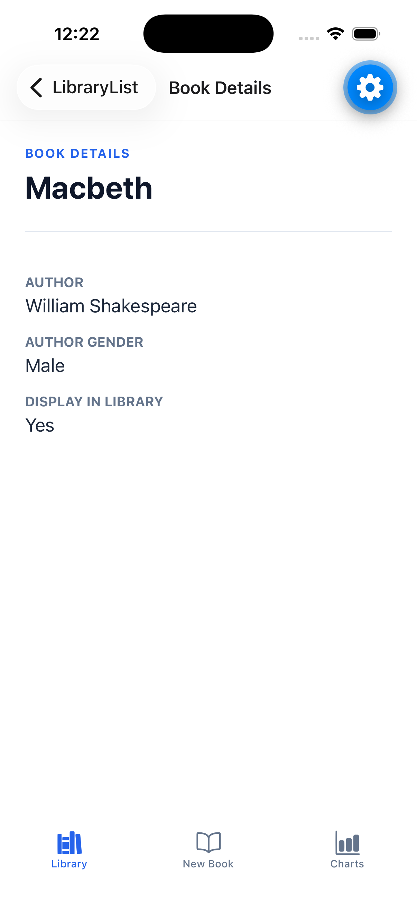
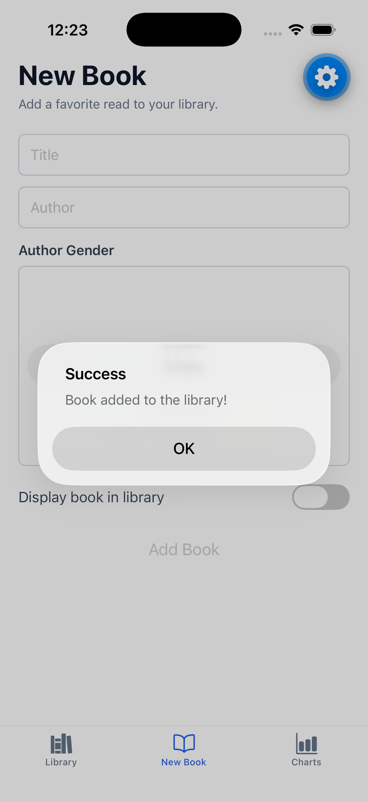
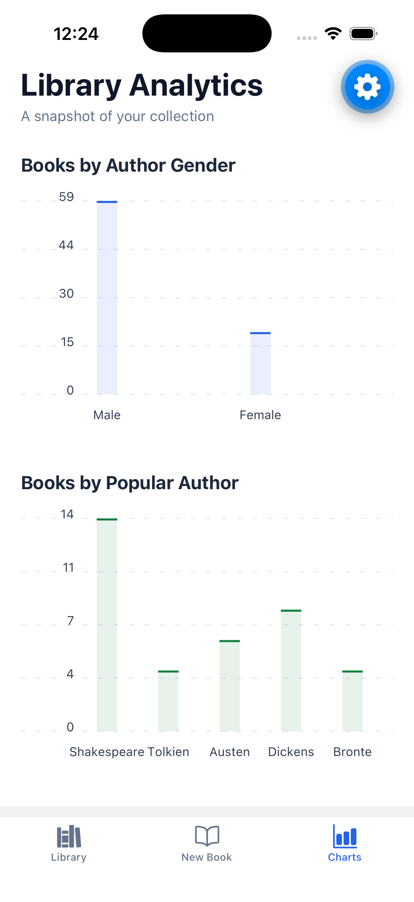

# BookManagerRN

**Platform:** React Native with Expo and TypeScript.

BookManager is an in-memory library manager built for React Native Lab 03. It provides a searchable-style library list with detail navigation and swipe-to-delete, a validated new-book form, and live analytics charts.

Repository: https://github.com/dbaldsin/hw_lab_dbaldsin

## Run

```bash
npm install
npm start
```

Press `i` to open the iOS Simulator. Run model tests with `npm test`.

## Features

- Library / New Book / Charts bottom-tab navigation
- Alphabetically sorted 77-book seed library with book details and swipe deletion
- Add-book form with author gender, display setting, validation, and success feedback
- Live author-gender and popular-author bar charts

## Simulator screenshots

Screenshots are captured from the iPhone 17 Pro Simulator.





