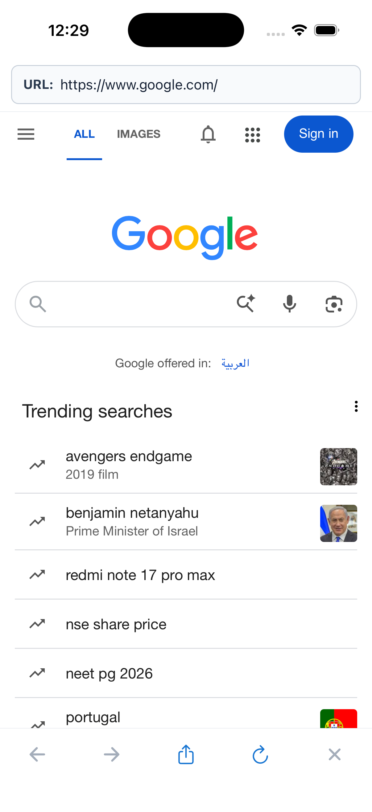
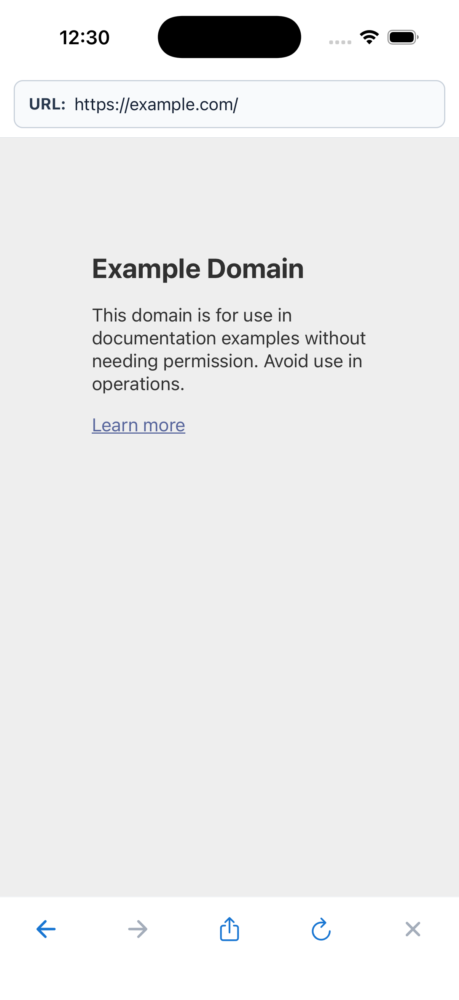
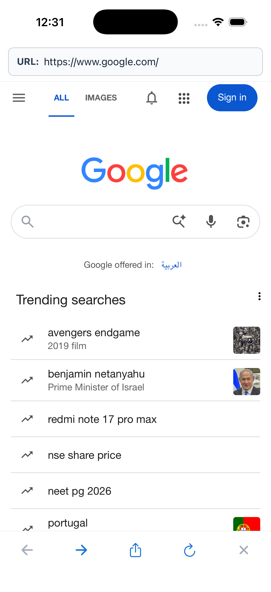
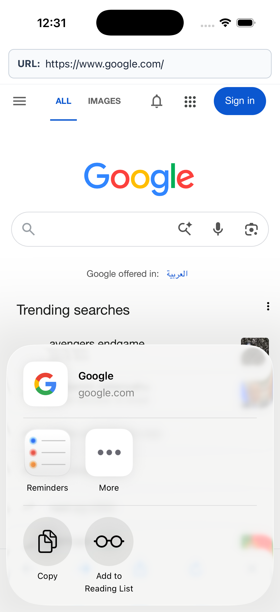

# Lab 4 — SimpleBrowser

**Platform:** React Native with Expo and TypeScript (tested on an iPhone 17 Pro simulator).

**Repository:** [dbaldsin/hw_lab_dbaldsin](https://github.com/dbaldsin/hw_lab_dbaldsin)

**Submission branch:** [`hw_lab4_SimpleBrowser`](https://github.com/dbaldsin/hw_lab_dbaldsin/tree/hw_lab4_SimpleBrowser)

## Run

```sh
npm install
npm run ios
```

Expo Go and an iOS simulator are required for the simulator run. Alternatively, use `npm start` and open the project in Expo Go. Run `npx tsc --noEmit` and `npm run lint` to check the source.

## Features

The browser starts at Google. Enter a website in the URL field and press **Go**; addresses without a scheme receive `https://`. The address field follows WebView navigation. The bottom bar offers Back, Forward, Share, Refresh, and Cancel; unavailable history and Cancel actions are disabled. Share opens the native share sheet for the current page URL.

## iPhone 17 Pro simulator screenshots

### Initial Google page



### Entered address loads another site

Typing `example.com` loads `https://example.com/`.



### Navigation history

After navigating back from Example Domain, the address returns to Google and Forward is enabled.



### Native share sheet


