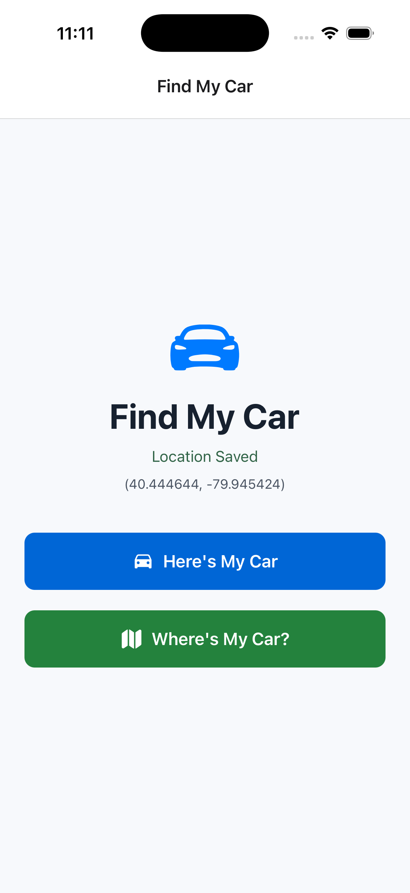
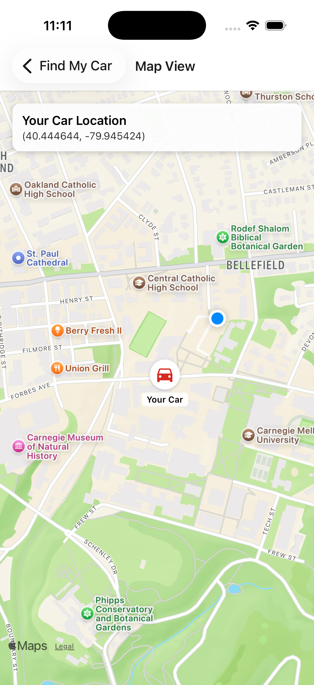

# Lab 08: FindMyCar (React Native)

Andrew ID: **dbaldsin**  
Repository: [hw_lab_dbaldsin](https://github.com/dbaldsin/hw_lab_dbaldsin)  
Branch: [hw_lab8_Findmycar](https://github.com/dbaldsin/hw_lab_dbaldsin/tree/hw_lab8_Findmycar)

## Run

Requires Node.js and an iOS simulator or Android device/emulator with Expo Go compatible with SDK 58.

```sh
npm ci
npm run ios
```

Use `npm run android` for Android or `npm start` to connect a device through Expo Go.
The development server uses one Metro worker and disables the inspector proxy to avoid automatic desktop DevTools downloads.

1. On iOS Simulator, choose **Features → Location → Custom Location** and enter latitude `40.444644`, longitude `-79.945424` (the lab's CMU example).
2. Tap **Here's My Car**, grant foreground location permission, and dismiss the saved alert.
3. Tap **Where's My Car?** to see the car marker, coordinate card, and device location.
4. Relaunch the app: the saved coordinate remains available.

Only the explicit Save action requests a GPS fix. The map displays the platform's live user location while open. The app does not request background location access. The coordinate stays in local AsyncStorage; it is not uploaded to a server. Map tiles require network access.

For a standalone Android build, configure a Google Maps API key as described in [Expo's react-native-maps documentation](https://docs.expo.dev/versions/latest/sdk/map-view/). The iOS simulator uses the native Apple map; no API key is needed for the lab's Expo Go workflow.

## Simulator evidence





## Implementation

- `models/CarCoordinate.ts`: coordinate interface, default `(0, 0)`, validation, and six-decimal formatting.
- `viewModels/LocationContext.tsx`: Context + Provider + hook, foreground permission and service checks, one-shot location capture, AsyncStorage restore/save/clear.
- `views/HomeView.tsx`: save/find actions, disabled states, loading spinner, saved-coordinate status, success/error alerts.
- `views/MapView.tsx`: native map, custom car marker and label, user location, compass, and coordinate card.
- `App.tsx` and `types.ts`: typed Home/Map native-stack navigation with shared context.
- `app.json`: iOS permission explanation, Android coarse/fine permissions, and Expo Location plugin.
- `__tests__/carCoordinate.test.ts`: all six required tests plus malformed/out-of-range coordinate coverage.

Every authored function, effect, and test callback has a purpose comment. Invalid saved JSON is reported without deleting the stored data. State changes only after storage succeeds. As prescribed by the lab, `(0, 0)` represents an unsaved location.

## Checks

```sh
npm run typecheck
npm test -- --watch=false
```

Screenshots in `screenshots/` are captured from the actual iOS Simulator using the lab's simulated CMU coordinate. See `VERIFICATION.md` for the final checks.

The optional distance calculation, connecting polyline, and Clear Location button are omitted; the required `clearLocation()` context operation is implemented.

## Submission

Upload **Lab08_dbaldsin_FindMyCar_Submission.zip** to Canvas. The archive contains this complete source project, the dependency lockfile, tests, screenshots, and verification notes. Generated dependencies, native build folders, development caches, and Git metadata are excluded. The lab handout is the supplied specification; it is not repackaged.
